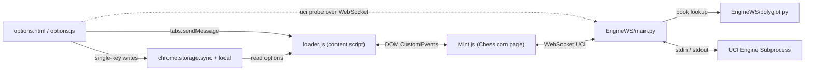

# Architecture and development

BetterMint uses vanilla HTML, CSS, and JavaScript with no frontend bundler and no runtime npm dependencies.
The local engine bridge uses Python 3.10 or newer with `websockets>=13.0`.



## Repository layout

- `BetterMint/manifest.json` defines the Manifest V3 extension with `storage`, `declarativeNetRequest`, and `https://*.chess.com/*` host permissions.
- `BetterMint/rules.json` defines declarative network request rules that block `/service/fair-play/*` XHR requests and `*play-monitor*` scripts and XHR requests.
- `BetterMint/js/loader.js` runs as a content script at `document_start` on `https://*.chess.com/*`. It bridges `chrome.storage` and `chrome.runtime.onMessage` to the page context through DOM `CustomEvent` messages and injects `js/Mint.js`.
- `BetterMint/js/Mint.js` runs in the page inside an immediately invoked function expression. It attaches to Chess.com `wc-chess-board` and `chess-board` elements, manages the WebSocket Universal Chess Interface client, tracks full move history, draws hints and move analysis, maintains the evaluation bar, runs human-like Auto Move timing, and runs Auto Queue.
- `BetterMint/html/options.html`, `BetterMint/css/options.css`, and `BetterMint/js/options.js` implement the options popup UI, live Universal Chess Interface option probing, saved configs, theme switching, and storage persistence.
- `BetterMint/css/evalbar.css` styles the fixed-position floating evaluation bar.
- `EngineWS/main.py` runs the asynchronous WebSocket server that manages engine subprocesses, handshake validation, concurrency limiting, and crash reporting.
- `EngineWS/polyglot.py` implements the pure-Python Polyglot `.bin` board tracker, Zobrist hasher, binary search reader, and weighted move picker.

## Message and storage flow

1. `options.js` writes individual changed extension options to `chrome.storage.sync` as single-key updates and broadcasts changes to open `https://*.chess.com/*` tabs through `chrome.tabs.sendMessage`.
2. `options.js` stores per-engine custom Universal Chess Interface options, saved configs, the active config name, and the selected popup theme in `chrome.storage.local`.
3. `loader.js` listens for `BetterMintGetOptions` from `Mint.js`, reads `chrome.storage.sync` plus the matching per-engine key from `chrome.storage.local`, and replies with `BetterMintSendOptions`.
4. When `loader.js` receives an `UpdateOptions` runtime message from `options.js`, it attaches any saved per-engine Universal Chess Interface options and dispatches `BetterMintUpdateOptions` to `Mint.js`.
5. If Chrome invalidates the content script context after an extension reload, `loader.js` checks `chrome.runtime.id` and `chrome.storage.sync` and detaches its `BetterMintGetOptions` listener.

## Engine synchronization and reconnection

- `UciEngineClient` in `Mint.js` validates `ws://` and `wss://` URLs before connecting, clears advertised `supportedUciOptions` on reconnect, reconnects with exponential backoff from 500 milliseconds to 30 seconds, pauses while the tab is hidden, and reconnects immediately on focus, visibility change, or position updates.
- Fatal `info string Error:` lines from EngineWS stop automatic reconnect loops until the user reconnects or switches engines.
- `GameController.syncPositionHistory` builds `position startpos moves ...` or `position fen <anchor> moves ...` commands from Chess.com move history or incremental ply tracking so engines and `PolyglotBoard` receive complete game history. If a position command cannot be tracked by `PolyglotBoard`, EngineWS clears the tracked board state so book lookups fall back to the engine.
- Before starting a new search, switching engines, or applying Universal Chess Interface options, `UciEngineClient` sends `stop` and waits up to 1000 milliseconds for `bestmove`. If the timeout expires, it resumes queued callbacks and increments a stale-move counter to discard late `bestmove` lines. Active searches are also stopped on `gameOver` and single-page app board detachment, and null bestmoves (`(none)`, `0000`, or same-square moves) are ignored cleanly.

## Running tests

Both the extension and EngineWS include headless unit test suites.

### Extension syntax and Node.js tests

Run syntax validation and all 11 Node.js test suites from the repository root with `npm test`, or directly:

```bash
node --check BetterMint/js/*.js
for t in BetterMint/tests/test_*.js; do node "$t" || exit 1; done
```

Test coverage in `BetterMint/tests/`:

- `test_book_moves.js` tests book move handling and Book classification.
- `test_disclosure_css.js` tests disclosure animation and slider CSS rules.
- `test_dynamic_uci_ui.js` tests dynamic Universal Chess Interface probing, rendering, debounced writes, editable slider badges, the Configs popover, and auto-scroll.
- `test_engine_pipeline.js` tests Universal Chess Interface parsing, candidate ranking, move analysis, and auto-move dispatch guards.
- `test_evalbar.js` tests evaluation bar formatting, flip state, and viewport offsets.
- `test_live_engine_switching.js` tests live WebSocket switching, backoff reconnects, and fatal error handling.
- `test_options_html.js` tests popup HTML structure, accessibility attributes, and control ordering.
- `test_options_schema.js` tests option default keys, script load order, and `loader.js` context invalidation guards.
- `test_position_history.js` tests Universal Chess Interface `position` command reconstruction from startpos and FEN anchors.
- `test_stop_evaluation.js` tests stop synchronization and stale `bestmove` discarding.
- `test_timing.js` tests Box-Muller log-normal timing, reflex and opening priority, and clock scaling.

### EngineWS Python tests

Run the 3 Python test files from `EngineWS`:

```bash
cd EngineWS
python3 -m unittest discover -s tests
```

Test coverage in `EngineWS/tests/`:

- `test_config_engine.py` tests config loading, path routing, origin checks, and command resolution.
- `test_polyglot.py` tests Polyglot board moves, Zobrist hashing, binary lookup, and weighted selection.
- `test_server_logging.py` tests Universal Chess Interface command logging, blocked debug log options, and crash handling.

## Publishing docs/BetterMint.wiki to GitHub Wiki

1. Enable Wikis in your GitHub repository settings and create an initial `Home` page in the GitHub web interface once to initialize the wiki repository.
2. Clone the wiki repository locally:

```bash
git clone https://github.com/y9felix/BetterMint.wiki.git
```

3. Copy the Markdown pages and `images/` directory from `docs/BetterMint.wiki/` into the cloned wiki directory, commit, and push to `master`.
