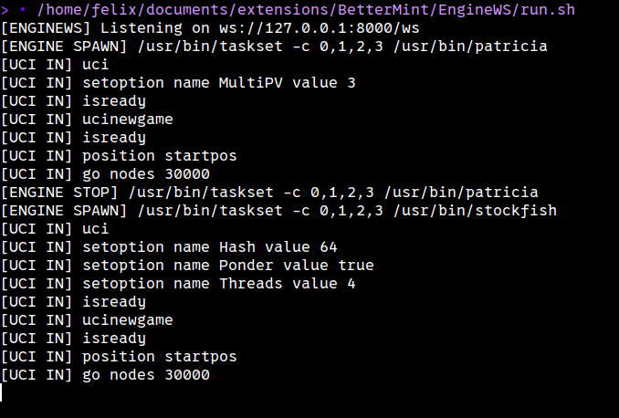

# EngineWS configuration

EngineWS is the local Python WebSocket bridge in `EngineWS/main.py`.
It spawns a separate chess engine subprocess for each WebSocket connection and forwards Universal Chess Interface lines between the browser and the engine.

## Configure engines in config.json

EngineWS reads `EngineWS/config.json` on each incoming connection.
If `config.json` does not exist, EngineWS creates a default file that maps `stockfish` to `["stockfish"]`.
If `config.json` contains invalid JSON or a root value that is not a JSON object, EngineWS logs a warning and uses the built-in Stockfish default.

Each entry in `engines` maps an engine name to a command array or a single binary path string:

```json
{
  "default": "stockfish",
  "books": {},
  "engines": {
    "stockfish": ["/usr/bin/taskset", "-c", "0,1,2,3", "/usr/bin/stockfish"],
    "patricia": ["/usr/bin/taskset", "-c", "0,1,2,3", "/usr/bin/patricia"],
    "maia-1500": ["/usr/bin/lc0", "--weights=/path/to/maia-1500.pb.gz"]
  }
}
```

- `default` names the engine that handles connections to `/ws`.
- `engines` defines every named engine command and its command-line arguments.
- `book` and `books` configure Polyglot opening books. See [Opening books](Opening-Books) for details.
- EngineWS executes each command array directly with `asyncio.create_subprocess_exec` rather than a shell. Put each flag and argument in its own list item.
- On Linux, you can prefix a command with `/usr/bin/taskset` and `-c` to pin the engine to specific CPU cores.

## Route engines by WebSocket URL

BetterMint selects an engine through the WebSocket path:

- `ws://localhost:8000/ws` launches the engine named in `default`.
- `ws://localhost:8000/ws/maia-1500` launches the `maia-1500` entry from `engines`.
- If the requested name is not in `engines`, EngineWS falls back to the `default` engine.
- Requests to any path outside `/ws` or `/ws/{engine_name}` fail during the handshake with HTTP 404.

You can switch WebSocket API URL in the BetterMint popup during an active game.
BetterMint stops the current search, closes the old socket, opens the new socket, and evaluates the current board position without reloading Chess.com.

<p align="center">
  <br>
  <em>EngineWS terminal output during runtime engine switching</em>
</p>

## Environment variables

EngineWS reads three optional environment variables at startup:

| Variable | Default | Effect |
| --- | --- | --- |
| `ENGINEWS_HOST` | `127.0.0.1` | Network interface that EngineWS binds to. |
| `ENGINEWS_PORT` | `8000` | TCP port that EngineWS listens on. |
| `BETTERMINT_VERBOSE` | `1` | Logs every incoming Universal Chess Interface command when not set to `0`. Set `BETTERMINT_VERBOSE=0` to disable command logging. |

Example on Linux or macOS:

```bash
ENGINEWS_PORT=8080 BETTERMINT_VERBOSE=0 ./run.sh
```

## Security and server limits

- EngineWS accepts WebSocket handshakes only from `https://chess.com`, `https://*.chess.com`, `chrome-extension://` origins, or clients that omit the `Origin` header. EngineWS rejects other origins with HTTP 403.
- EngineWS allows up to 8 concurrent engine processes at once. Connections beyond 8 close with WebSocket code 1013.
- EngineWS drops any incoming `setoption` command that targets `debug log file` or `logfile`.
- If an engine binary is missing, fails to start, or exits with a non-zero status without receiving `quit`, EngineWS forwards an `info string Error:` line with the captured stderr detail to BetterMint and closes the connection.
