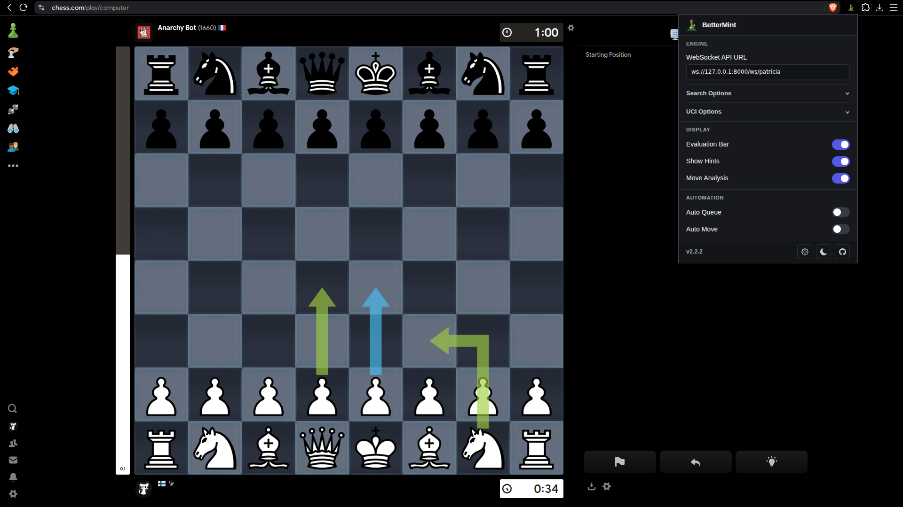

# BetterMint wiki

BetterMint is a Manifest V3 Chrome extension that connects Chess.com to Universal Chess Interface engines over WebSocket.
The extension draws an evaluation bar, move hint arrows, and move quality highlights directly on the Chess.com board.
It also automates move execution with configurable deliberation delays and queues new matches after a game ends.

   
  <em>BetterMint board overlays (evaluation bar, move arrows) and options popup on Chess.com</em>

## Requirements

- A Chromium browser such as Chrome, Brave, or Edge.
- Either a remote WebSocket endpoint from [bettermint-sockets](https://github.com/ProtonDev-sys/bettermint-sockets) or a local EngineWS server running Python 3.10 or newer with a chess engine binary such as Stockfish or lc0.

## Pages in this wiki

- [Installation and setup](Installation-and-Setup) covers connecting to remote sockets, running EngineWS locally, and loading the unpacked extension.
- [EngineWS configuration](EngineWS-Configuration) documents `config.json`, named engine routes, environment variables, and server limits.
- [Opening books](Opening-Books) explains how to configure Polyglot `.bin` opening books globally or per engine.
- [Settings and popup guide](Settings-and-Popup-Guide) walks through every control in the Engine, Display, and Automation sections, saved configs, and popup themes.
- [Human-like timing guide](Human-like-Timing-Guide) explains how each Auto Move timing slider works and lists starting values for Bullet, Blitz, and Rapid.
- [Troubleshooting](Troubleshooting) lists common connection, engine launch, and browser reload errors with their fixes.
- [Architecture and development](Architecture-and-Development) documents the extension modules, WebSocket bridge, and declarative network rules.
