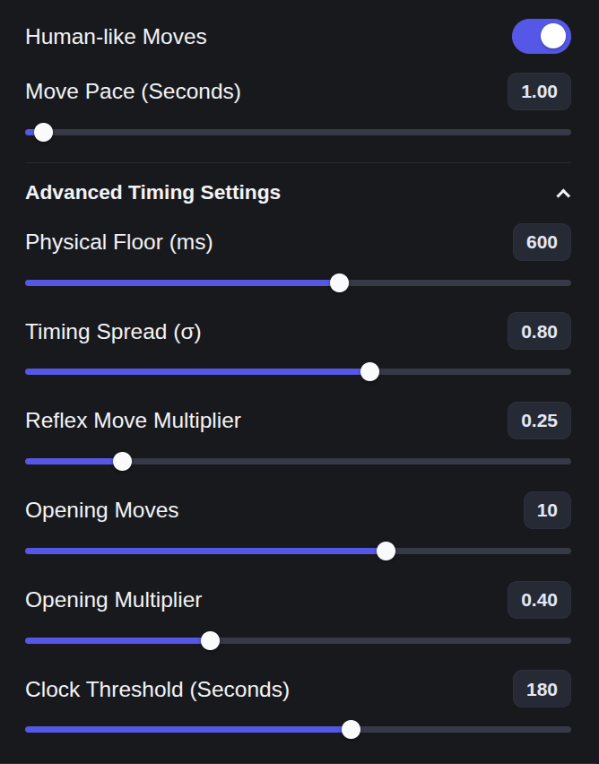

# Human-like timing guide

When Auto Move and Human-like Moves are both enabled, BetterMint calculates a different deliberation delay for every turn instead of waiting a fixed number of seconds.
When Human-like Moves is off, BetterMint executes moves with a 0-millisecond delay.

   
  <em>Advanced Timing Settings expanded in the Automation section</em>

## How the delay calculation works

1. BetterMint records the timestamp as soon as your turn starts.
2. BetterMint starts with Move Pace in milliseconds as the base median think time.
3. BetterMint checks two move-type modifiers in priority order:
   - If Reflex Move Multiplier is below `1.00` and either only one legal move exists or the best move captures on the opponent's last destination square, BetterMint multiplies the median think time by Reflex Move Multiplier.
   - Otherwise, if Opening Moves is above `0`, Opening Multiplier is below `1.00`, and the current full move number is at or below Opening Moves, BetterMint multiplies the median think time by Opening Multiplier.
4. If Clock Threshold is above `0` and your remaining clock on the bottom board clock is below Clock Threshold, BetterMint scales the median think time down proportionally by remaining seconds divided by Clock Threshold.
5. BetterMint draws a random sample from a log-normal distribution using the adjusted median think time, Physical Floor, and Timing Spread, then adds Physical Floor.
6. BetterMint subtracts the time already spent waiting for the engine search since the start of your turn.
7. If a move occurs, the game ends, the board resets, or you turn off Auto Move before the timer finishes, BetterMint cancels the pending timer.

## Timing controls reference

| Control | Range | Step | Default | Off value | Effect |
| --- | --- | --- | --- | --- | --- |
| Move Pace (Seconds) | 0.50 to 30.00 | 0.05 | 12.50 | None | Base median think time per move in seconds. |
| Physical Floor (ms) | 50 to 1000 | 10 | 600 | None | Minimum delay added to every move to model reaction and mouse movement. |
| Timing Spread (σ) | 0.10 to 1.20 | 0.05 | 0.80 | None | Log-normal standard deviation. Higher values produce occasional short moves and occasional long thinks. Lower values cluster delays tightly around Move Pace. |
| Reflex Move Multiplier | 0.10 to 1.00 | 0.05 | 0.25 | 1.00 | Scales median think time on forced single legal moves and recaptures. |
| Opening Moves | 0 to 15 | 1 | 10 | 0 | Full move number up to which Opening Multiplier applies. |
| Opening Multiplier | 0.10 to 1.00 | 0.05 | 0.40 | 1.00 | Scales median think time during the opening phase when a move is not already a reflex move. |
| Clock Threshold (Seconds) | 0 to 300 | 5 | 180 | 0 | Starts scaling delays linearly toward 0 once your clock drops below this many seconds. |

## Example starting profiles

Save separate entries in the Configs menu for each time control you play.
These values are starting points that you can adjust to match your own pace:

| Setting | Bullet 1+0 | Blitz 3+0 | Rapid 10+0 |
| --- | --- | --- | --- |
| Move Pace (Seconds) | 1.50 | 3.50 | 10.00 |
| Physical Floor (ms) | 250 | 450 | 600 |
| Timing Spread (σ) | 0.55 | 0.70 | 0.80 |
| Reflex Move Multiplier | 0.20 | 0.25 | 0.25 |
| Opening Moves | 8 | 10 | 10 |
| Opening Multiplier | 0.40 | 0.40 | 0.40 |
| Clock Threshold (Seconds) | 30 | 60 | 180 |
