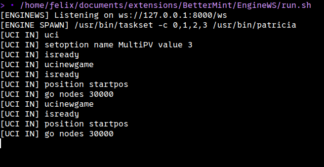
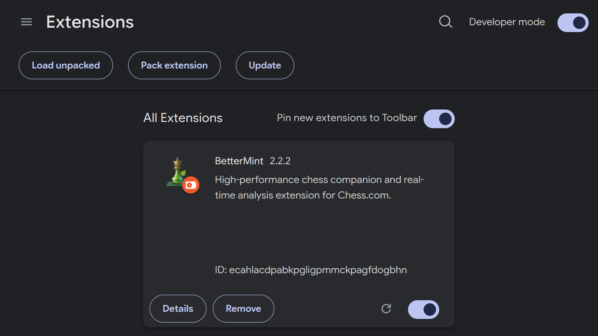
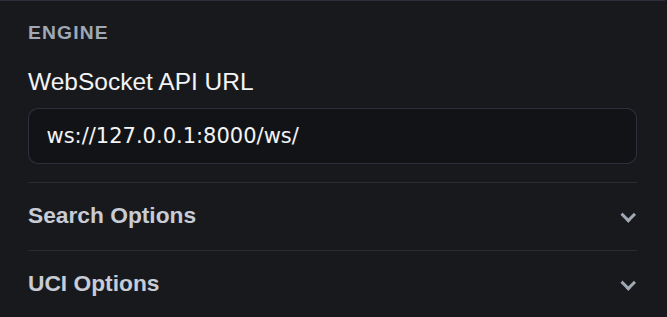

# Installation and setup

BetterMint needs two parts to analyze games.
First, pick an engine backend.
Second, load the Chrome extension and point it at your backend WebSocket URL.

## Choose an engine backend

You can connect BetterMint to a hosted WebSocket server or run engines on your own machine with EngineWS.

### Option 1. Remote sockets

Use a hosted WebSocket URL from [bettermint-sockets](https://github.com/ProtonDev-sys/bettermint-sockets).
This option requires no Python setup and no local chess engine binaries.
Copy the endpoint URL and continue to the Chrome extension steps below.

### Option 2. Local EngineWS server

Run local Universal Chess Interface engines such as Stockfish, Patricia, or Maia through `EngineWS`.

1. Install Python 3.10 or newer and at least one Universal Chess Interface engine binary.
2. Install the WebSocket dependency from `EngineWS/requirements.txt`:

```bash
cd EngineWS
pip install -r requirements.txt
```

3. Edit `EngineWS/config.json` and point each engine entry at your installed binary paths:

```json
{
  "default": "stockfish",
  "engines": {
    "stockfish": ["stockfish"],
    "maia": ["lc0", "--weights=/path/to/maia-1500.pb.gz"]
  }
}
```

4. Start the server on `127.0.0.1:8000`:
   - On Linux or macOS, run `./run.sh`.
   - On Windows, run `run.bat`.

The terminal prints `[ENGINEWS] Listening on ws://127.0.0.1:8000/ws` when the server is ready.

<p align="center">
  <br>
  <em>EngineWS WebSocket server startup output in terminal</em>
</p>

## Load the Chrome extension

1. Open `chrome://extensions` in Chrome, Brave, or Edge.
2. Turn on Developer mode in the top right corner.
3. Click Load unpacked and select the `BetterMint` directory inside this repository.

<p align="center">
  <br>
  <em>BetterMint loaded as an unpacked extension in Developer mode</em>
</p>

4. Pin BetterMint to the browser toolbar and open the options popup.
5. Enter `ws://localhost:8000/ws` in WebSocket API URL if you run EngineWS locally, or paste your remote socket URL.
6. Open [Chess.com](https://www.chess.com) and start a game or bot match.

<p align="center">
  <br>
  <em>WebSocket API URL configuration in the BetterMint popup</em>
</p>

## Update BetterMint

1. Pull the latest repository changes or replace the local `BetterMint` folder.
2. Open `chrome://extensions` and click the reload icon on the BetterMint card.
3. Refresh any open Chess.com tabs so the updated content script attaches to the page.
4. If `EngineWS/requirements.txt` changed, run `pip install -r requirements.txt` again and restart EngineWS.
