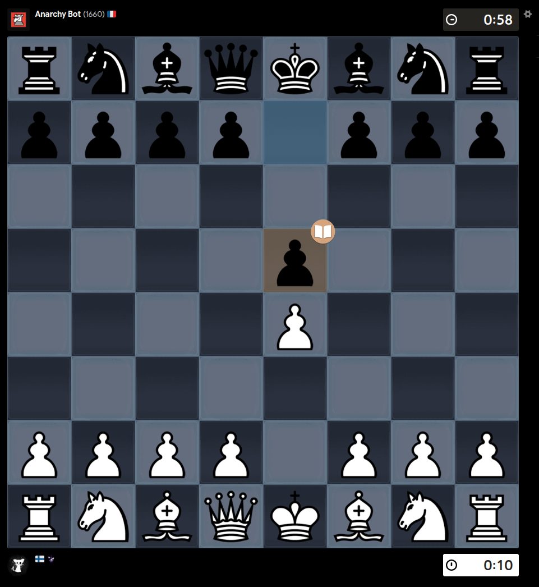

# Opening books

EngineWS supports Polyglot `.bin` opening books through `EngineWS/polyglot.py`.
When a board position matches an entry in the configured book, EngineWS returns a book move immediately without starting an engine search.

## Configure opening books in config.json

You can set one default book for all engines with `book`, assign specific books per engine with `books`, or combine both.
Relative paths resolve against the `EngineWS` directory.
Absolute paths work on Linux, macOS, and Windows.

```json
{
  "default": "stockfish",
  "book": "books/default.bin",
  "books": {
    "stockfish": "/path/to/gm2001.bin",
    "maia-1500": ""
  },
  "engines": {
    "stockfish": ["stockfish"],
    "maia-1500": ["lc0", "--weights=/path/to/maia-1500.pb.gz"]
  }
}
```

Resolution rules:

1. EngineWS checks whether the active engine name exists as a key in `books`.
2. If the key exists, EngineWS uses that value. Setting an empty string `""` disables the global `book` for that engine.
3. If the key does not exist in `books`, EngineWS falls back to the top-level `book` string.
4. If the resolved `.bin` file is missing on disk, EngineWS logs a warning and runs the engine without a book.

## How book lookups work

1. BetterMint sends the full move list in the `position startpos moves ...` or `position fen ... moves ...` command so EngineWS tracks the exact board state, castling rights, and en passant square.
2. When BetterMint sends a `go` command, EngineWS computes the Polyglot Zobrist hash of the position and binary-searches the `.bin` file.
3. If one or more entries match, EngineWS picks one move using weighted random sampling from the book weights.
4. EngineWS sends `info string book <ordered_moves>` followed by `bestmove <selected_move>` directly to BetterMint.
5. If no entry matches—or if the `position` command cannot be tracked by `PolyglotBoard`—EngineWS forwards the `go` command to the chess engine as normal.

## How book moves appear on Chess.com

- When Show Hints is enabled, BetterMint draws the selected book move arrow on the board.
- When Move Analysis is enabled, BetterMint marks played book moves with the Book highlight color `#a88865` and the Book badge on the destination square.
- When Auto Move is enabled, BetterMint plays the selected book move using your active timing settings.

<p align="center">
  <br>
  <em>Book move classification badge and hint arrow on Chess.com</em>
</p>
