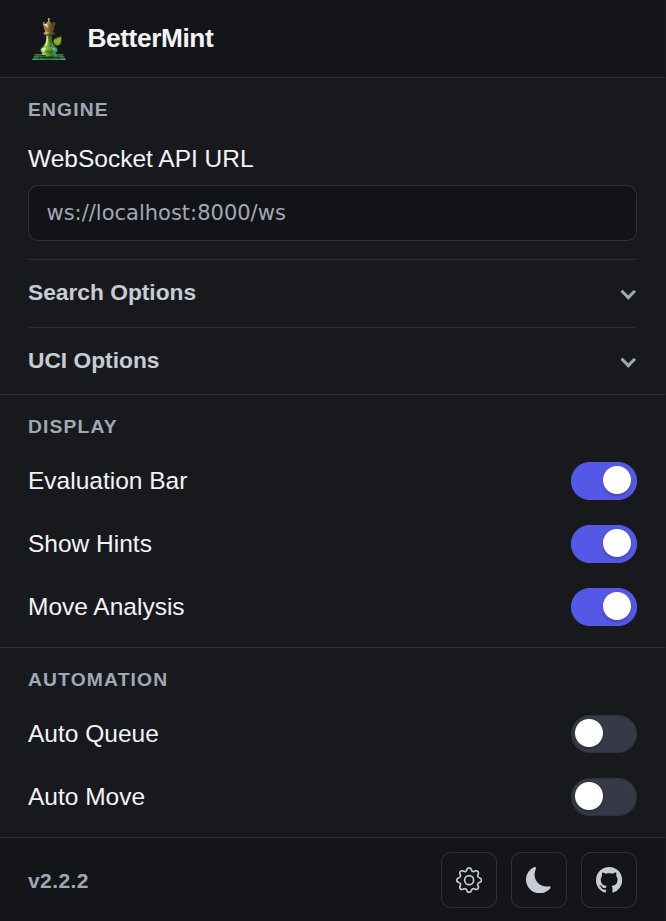
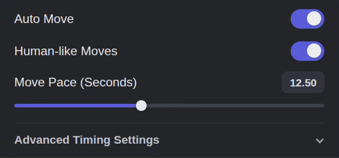
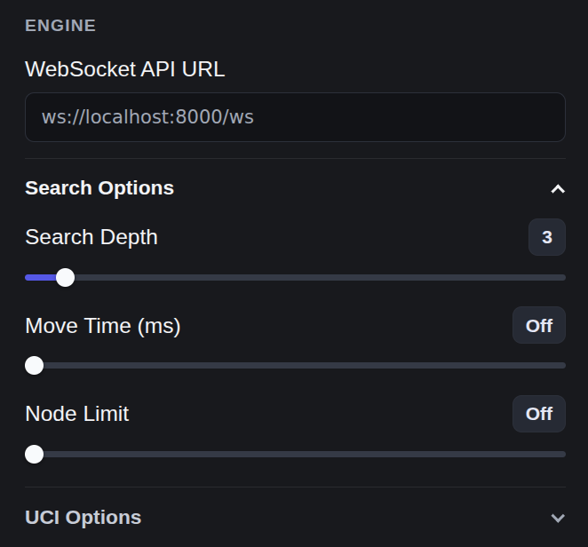
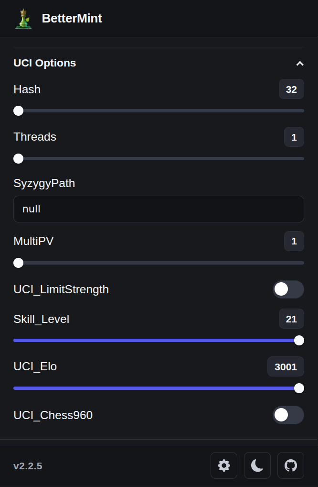
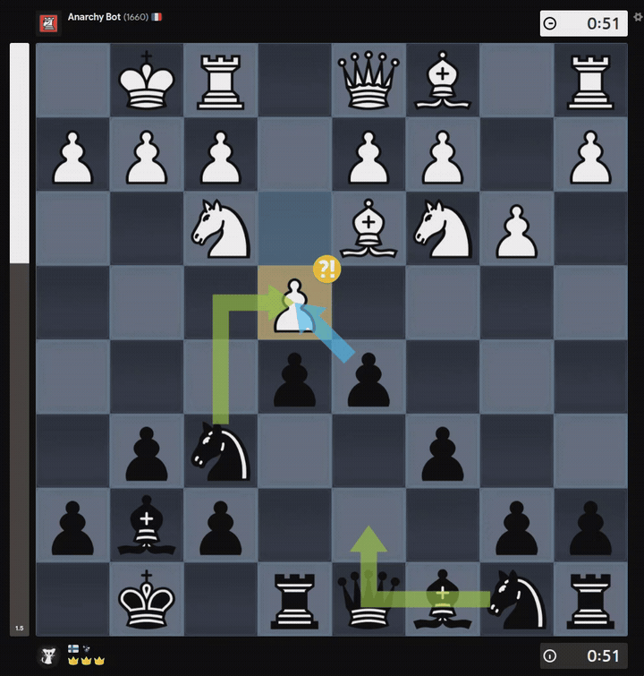
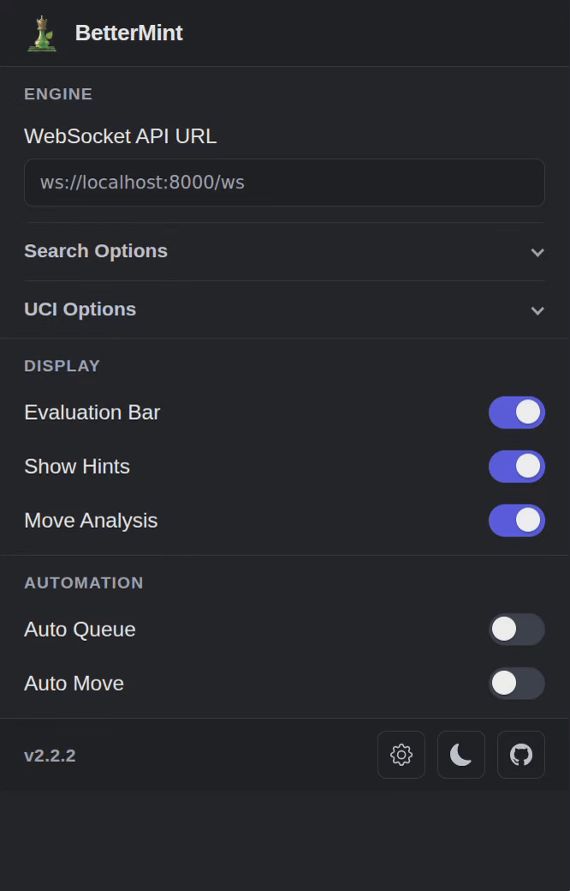
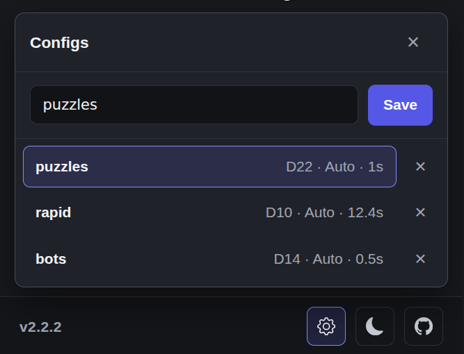
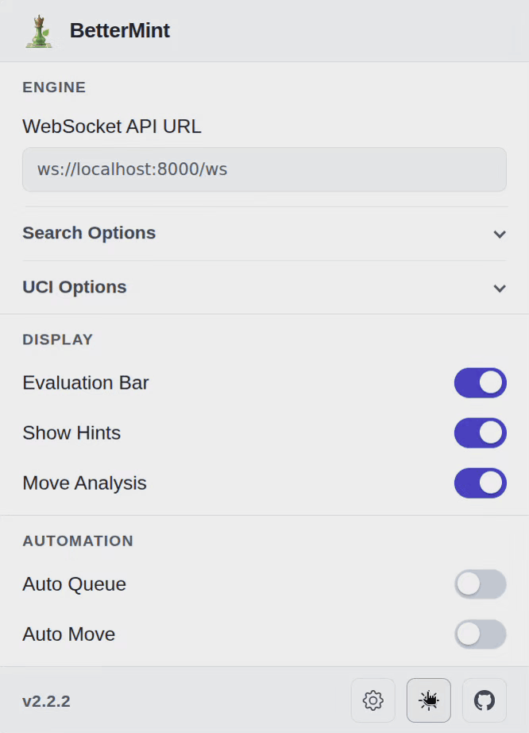

# Settings and popup guide

The BetterMint options popup groups controls into three sections: Engine, Display, and Automation.
A fixed footer at the bottom holds the extension version, status messages, the Configs menu, the theme toggle, and a link to the GitHub repository.

   
  <em>BetterMint options popup overview</em>

## Direct value editing on sliders

Every range slider displays a clickable numeric badge on the right side of its header.
Click the badge to type an exact number with the keyboard.
Press Enter to save or Escape to cancel.
Values outside the slider bounds clamp to the slider minimum or maximum.
For sliders that support an off state, you can type `Off` directly into the badge.

   
  <em>Inline numeric badge editing on range sliders</em>

## Engine section

The Engine section controls which engine BetterMint connects to, how deep or long each search runs, and what engine-specific options apply.

### WebSocket API URL

Enter the WebSocket address of your local EngineWS server, such as `ws://localhost:8000/ws`, or a named engine route such as `ws://localhost:8000/ws/maia-1500`.
Changing the URL switches engines on open Chess.com tabs without reloading the page.

### Search Options

Expand Search Options to set bounds for the `go` command.
When all three limits are set to `Off`, BetterMint falls back to `go depth 1`.

| Control | Range | Step | Default | Off value |
| --- | --- | --- | --- | --- |
| Search Depth | 0 to 50 | 1 | 3 | 0 |
| Move Time (ms) | 0 to 5000 | 50 | Off | 0 |
| Node Limit | 0 to 5,000,000 | 10,000 | Off | 0 |

   
  <em>Engine section with Search Options expanded</em>

### UCI Options

Expand UCI Options to query the connected engine over WebSocket with the `uci` command.
BetterMint displays a `Connecting to engine...` status message while waiting up to 4 seconds for the WebSocket connection and up to 4 seconds for `uciok`.
Once the engine responds, BetterMint renders controls for every option the engine advertises:

- Check options render as toggle switches.
- Spin options render as range sliders with clickable numeric badges.
- Combo options render as dropdown menus.
- String options render as text inputs.
- Button options render as action buttons that send `setoption name <option>` immediately to active Chess.com tabs.

BetterMint stores custom UCI option values separately for each WebSocket API URL.
Switching to another engine URL loads that engine's saved options.

   
  <em>Dynamic UCI Options loaded from the connected engine</em>

## Display section

Each visual overlay on Chess.com has its own toggle switch in the Display section.

### Evaluation Bar

Places a vertical evaluation bar to the left of the Chess.com board.
The bar is 30 pixels wide on viewports of 960 pixels or wider and 20 pixels wide on narrower viewports.
It displays an abbreviated score inside the bar: `0.0` for near-equal positions, one decimal place up to `9.9`, whole numbers from `10` up, and `M<n>` for forced mates.
The bar flips automatically when you flip the board or play as Black.

### Show Hints

Draws colored arrows on the board for top engine candidate moves up to the active `MultiPV` setting.
Arrow colors match the active Chess.com board arrow colors when available, or fall back to these defaults:

- The best move arrow is green `#15781b`.
- Ranks 2 and 3 are orange `#e68f00`.
- Ranks 4 through 6 are blue `#003088`.
- Remaining moves are dark red `#882020`.

When a candidate line contains a forced mate, BetterMint also places a mate icon effect on the target square.

### Move Analysis

Highlights the destination square of each played move and attaches a move quality badge based on expected points loss:

- Book `#a88865`
- BestMove `#9eba5a`
- Excellent `#96bc4b`
- Good `#96af8b`
- Inaccuracy `#f0c15c`
- Mistake `#e6912c`
- Blunder `#b33430`
- MissedWin `#dbac16`

   
  <em>Evaluation bar, hint arrows, and move analysis in active play</em>

## Automation section

The Automation section contains controls for matchmaking and automated play.
When you expand Auto Queue, Auto Move, Human-like Moves, or Advanced Timing Settings, the popup scrolls automatically so newly revealed controls stay visible above the footer.

- Auto Queue clicks visible matchmaking buttons after a game ends, including Play Again, New Opponent, Next Game, New Game, and Rematch.
- Rematch first appears when Auto Queue is on. When enabled, BetterMint looks for a Rematch button before searching for general new-game buttons.
- Auto Move plays the engine's chosen move on your turn after confirming the board is in playing mode and the position matches the evaluated FEN.
- Human-like Moves appears when Auto Move is on. Leave it on for varied deliberation delays, or turn it off to execute moves with a 0-millisecond delay. See [Human-like timing guide](Human-like-Timing-Guide) for every timing slider.

   
  <em>Auto Queue and Auto Move controls in the Automation section</em>

## Saved configs

Click the gear icon in the footer to open the Configs menu.
Type a name into Config name and click Save, or press Enter, to save your current extension settings together with the active engine's custom UCI options.
Saving with an existing name updates that entry case-insensitively.

Each saved entry shows its name and a short summary of Search Depth, Auto or Manual mode, and Move Pace in seconds.
Click a saved config to apply its settings immediately to all open Chess.com tabs.
Click the `×` button next to an entry to delete it.

   
  <em>Configs popover showing saved configs</em>

## Popup themes

Click the theme button in the footer to cycle through four themes.
On first run, BetterMint picks Light or Dark based on your operating system color scheme.
Your chosen theme persists across browser sessions.

1. Dark uses dark slate panels with violet accents.
2. Light uses white and cool-gray panels with indigo accents.
3. Black uses a borderless pure-black background with elevated dark controls.
4. Chess.com uses dark charcoal panels, warm move-chip badges, and green primary buttons matched to Chess.com.

   
  <em>Cycling between Dark, Light, Black, and Chess.com themes</em>

