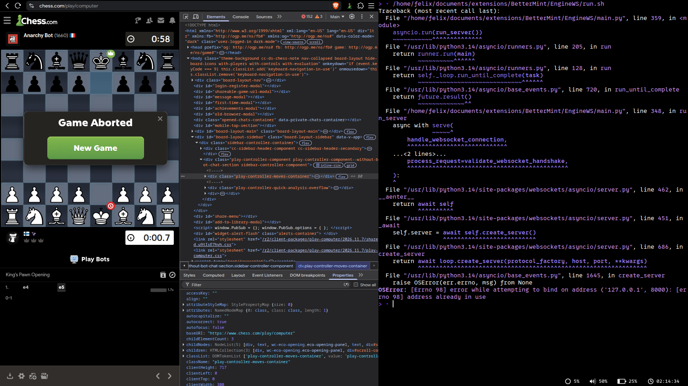

# Troubleshooting

Use this page to diagnose common BetterMint and EngineWS issues.
When checking errors, open both the EngineWS terminal window and the Chess.com browser DevTools Console.

   
  <em>Browser DevTools console alongside EngineWS terminal logs</em>

## Unable to connect to engine

UCI Options displays `Unable to connect to engine.`, `Connection timed out.`, or `Invalid WebSocket URL (use ws:// or wss://).`, and no arrows appear on Chess.com.

1. Confirm EngineWS is running and prints `[ENGINEWS] Listening on ws://127.0.0.1:8000/ws`.
2. Verify the WebSocket API URL in the BetterMint popup matches the host, port, and path of your server, such as `ws://localhost:8000/ws`.
3. If you use a remote socket from `bettermint-sockets`, check that the endpoint URL starts with `ws://` or `wss://` and that the remote server is online.
4. Check whether another local process is already bound to port 8000. You can run EngineWS on another port by setting `ENGINEWS_PORT=8080`.

## Engine handshake timed out

UCI Options displays `Engine handshake timed out.` after 4 seconds (or `Engine connection closed before handshake.` if the socket drops before `uciok`).

1. Confirm the configured binary is a Universal Chess Interface engine that responds to `uci` with `uciok`.
2. If you run `lc0` or another neural-network engine, verify the weights file path is valid and finishes loading quickly.
3. Look at the EngineWS terminal for `[ENGINE STDERR]` output from the engine process.

## Engine binary not found or failed to start

EngineWS prints `[ENGINE ERROR] Binary not found` or `[ENGINE ERROR] Failed to start engine`, and DevTools logs `[BetterMint] Error: Engine binary '...' not found`.

1. Open `EngineWS/config.json` and check that the executable path exists and has execute permissions.
2. On Windows, include the `.exe` extension or put the engine directory on your `PATH`.
3. Keep each flag as a separate string inside the command array, for example `["/usr/bin/lc0", "--weights=/path/to/maia-1500.pb.gz"]`.
4. After fixing `config.json`, switch to another URL and back, or reload the Chess.com tab, because BetterMint stops automatic reconnection loops after a fatal engine error.

## Engine crashed during a game

DevTools logs `[BetterMint] Error: Engine crashed (exit <code>)` and EngineWS closes the connection with code 1011.

1. Read the `[ENGINE STDERR]` lines in the EngineWS terminal to see why the engine exited.
2. Lower high UCI Options values such as `Hash` or `Threads` if the engine ran out of memory or exceeded CPU limits.
3. For `lc0`, verify that your backend and weights file match your GPU or CPU build.

## Extension stops working after reloading BetterMint

When you click reload in `chrome://extensions`, Chrome invalidates content scripts running in already-open tabs.

1. Refresh your open Chess.com tabs once after reloading BetterMint.
2. The fresh content script reattaches to the board and restores communication with the options popup.

## Too many concurrent connections

EngineWS closes new sockets with WebSocket code 1013 when 8 engine processes are already active.

1. Close unused Chess.com tabs that still hold open connections to EngineWS.
2. Wait a few seconds for EngineWS to print `[ENGINE STOP]` and free slots.

## Arrows or evaluation bar do not appear

1. Open the BetterMint popup and confirm Show Hints and Evaluation Bar are turned on in the Display section.
2. Confirm you are on a Chess.com page with an active `wc-chess-board` or `chess-board` element.
3. Check the DevTools Console for `[BetterMint]` or `WebSocket` error messages.
4. Check that your browser window is wide enough that the board has at least 50 pixels of visible width and height inside the viewport.

## Opening book moves do not trigger

1. Confirm your `config.json` contains a valid `book` path or an entry for your active engine inside `books`.
2. Check the EngineWS terminal for `[CONFIG WARN] Polyglot book '...' not found`.
3. Make sure the book file is in Polyglot `.bin` format.
4. Remember that EngineWS looks up exact Polyglot Zobrist hashes. Once the game leaves theory in the `.bin` file, EngineWS forwards the search to the chess engine.
